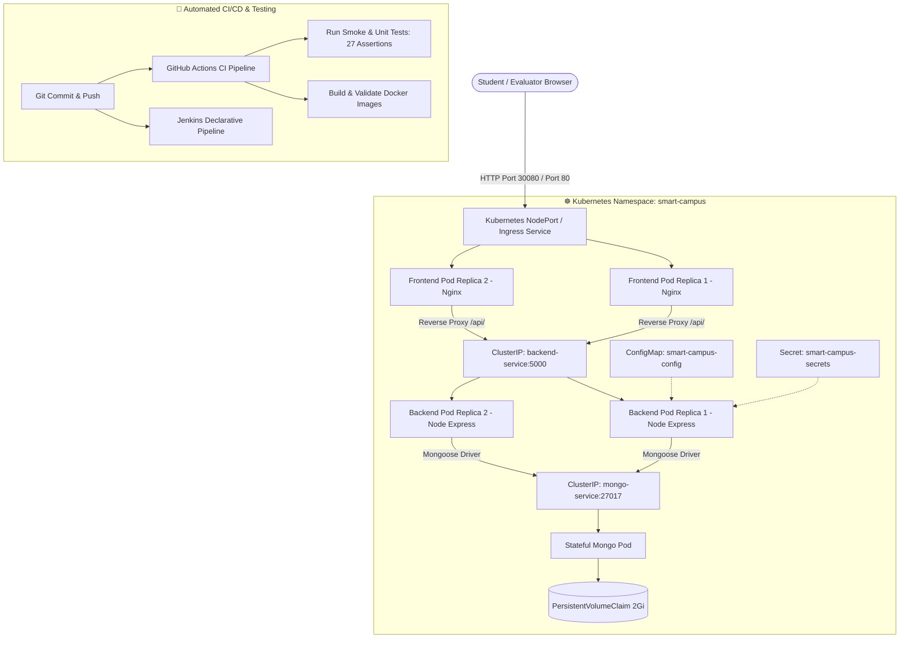

# 🎓 Smart Campus Portal & DevOps Management System
> **Swami Keshvanand Institute of Technology, Management & Gramothan (SKIT), Jaipur**  
> **Department of Computer Science & Engineering | DEVOPS_2026_CS_E-25**  

---

## 📌 Project Overview

**Smart Campus** is an enterprise-grade institutional web platform and DevOps management solution engineered for college students, faculty, and administrators. The system streamlines campus daily operations including digital hostel outing gate passes, institutional identity verification, academic syllabus & RTU question paper hub, lab & auditorium reservations, grievance redressal, and an intelligent **Campus AI Assistant**.

The project is built and packaged using modern **DevOps & Cloud-Native practices**, featuring:
- **Container Orchestration with Kubernetes (K8s)** (Namespaces, Multi-replica Deployments, Services, ConfigMaps, Secrets, and PVCs)
- **Multi-Container Docker Architecture** (Nginx Reverse Proxy + Node.js Express REST API + MongoDB 6.0)
- **Continuous Integration (CI) with GitHub Actions**
- **Automated Declarative Jenkins Pipeline** (`Jenkinsfile`)
- **Automated Testing & Linting** (Automated smoke and unit test suite)
- **Observability Roadmap** (Prometheus metric exporter & Grafana visual dashboards)
- **Automated Weekly Progress Reporting** (Python ReportLab PDF Generation cron)

---

## 🏗️ DevOps & Kubernetes Architecture



---

## 🛠️ Technology Stack

- **Frontend:** Vanilla HTML5, Modern CSS3 (Glassmorphism, Dark/Light Themes), JavaScript (ES6+), Interactive Campus AI Assistant
- **Backend:** Node.js, Express.js REST API
- **Database:** MongoDB 6.0 & Mongoose ODM
- **Containerization:** Docker, Docker Compose, Nginx Reverse Proxy
- **Orchestration:** Kubernetes (K8s) manifests (Deployments, Services, ConfigMaps, Secrets, PVC)
- **CI/CD:** Jenkins (`Jenkinsfile`), GitHub Actions (`.github/workflows/ci.yml`)
- **Reporting Engine:** Python 3.11, ReportLab, Matplotlib

---

## 🚀 Quick Start Guide

### Option 1: Run via Kubernetes (Production Orchestration)

Make sure `kubectl` is configured (Docker Desktop Kubernetes, Minikube, or K8s cluster):

```bash
# 1. Apply complete Kubernetes manifests in smart-campus namespace
kubectl apply -k k8s/

# 2. Verify all pods, deployments, and services
kubectl get all -n smart-campus

# 3. Access the application in browser
# Frontend UI: http://localhost:30080
# Backend Healthcheck: http://localhost:5000/health (via port-forward if needed)
```

To clean up Kubernetes resources:
```bash
kubectl delete -k k8s/
```

---

### Option 2: Run via Docker Compose (Multi-Container Stack)

Ensure Docker Desktop is running:

```bash
# 1. Build and start multi-container stack in detached mode
docker compose up -d --build

# 2. Check status of running containers
docker compose ps
```

Access points:
- **Frontend Web UI:** [http://localhost](http://localhost) (Port 80)
- **Backend API & Healthcheck:** [http://localhost:5000/health](http://localhost:5000/health) (Port 5000)
- **MongoDB:** `mongodb://localhost:27017/smartcampus`

To stop containers:
```bash
docker compose down
```

---

### Option 3: Local Development Setup

#### 1. Setup Backend
```bash
cd server
cp .env.example .env
npm install
npm run test     # Run automated test suite (27 tests)
npm start        # Starts server on http://localhost:5000
```

#### 2. Open Frontend
Open `client/index.html` or `client/dashboard.html` in your browser. The frontend automatically synchronizes with the Express REST API and features an intelligent floating **Campus AI Assistant** with fallback offline support.

---

### Option 4: Instant Public Live Link for Project Submission

To share a live link with college evaluators without manual server hosting:

```bash
# 1. Start your local server or Docker container (Port 5000 or 80)
npm start --prefix server

# 2. Expose a secure public HTTPS tunnel using localtunnel
npx localtunnel --port 5000
```
This generates a live public URL (e.g. `https://smart-campus-devops.loca.lt`) accessible from any smartphone, laptop, or evaluator device!

---

## ⚙️ Automated Testing & Code Quality

Run tests from the root directory:
```bash
# Run backend test suite (27 unit & smoke tests)
npm test

# Run syntax linting
npm run lint --prefix server
```

---

## 🔄 Jenkins CI/CD Pipeline (`Jenkinsfile`)

The repository includes a production-grade **Declarative Jenkins Pipeline** that automates:
1. **Source Checkout & Git Audit:** Checks out code and reads branch/commit metadata.
2. **Environment Verification:** Checks Node, Docker, and CLI versions.
3. **Dependency Resolution:** Installs backend dependencies cleanly.
4. **Syntax Validation & Linting:** Validates JavaScript files.
5. **Automated Unit & Smoke Testing:** Executes `npm test` with 27 assertions.
6. **Docker Compose Linting:** Runs `docker compose config` to validate schemas.
7. **Container Image Build:** Builds `smart-campus-backend` and `smart-campus-frontend`.
8. **Deployment & Liveness Probe:** Starts stack and checks `/health` endpoint.

---

## 📡 Core API Endpoints

| Method | Endpoint | Description |
| :--- | :--- | :--- |
| `GET` | `/health` | Liveness healthcheck probe |
| `POST` | `/api/auth/register` | Register new institutional user |
| `POST` | `/api/auth/login` | Authenticate student / faculty & get JWT |
| `GET` | `/api/gatepass` | Fetch all outing gate passes |
| `POST` | `/api/gatepass/apply` | Submit hostel outing gate pass request |
| `PUT` | `/api/gatepass/:id/status` | Warden approve / reject gate pass |
| `GET` | `/api/library` | Retrieve RTU syllabi & exam question papers |
| `POST` | `/api/booking/book` | Reserve campus facilities (labs, seminar halls) |
| `GET` | `/api/notices` | Fetch campus circulars & announcements |
| `POST` | `/api/notices` | Post new administrative notice |
| `GET` | `/api/complaints` | Fetch student grievances & repair tickets |
| `POST` | `/api/complaints` | Submit new grievance ticket |
| `GET` | `/api/lostfound` | Fetch lost & found item feed |
| `POST` | `/api/lostfound` | Report misplaced or found campus item |
| `POST` | `/api/ai/chat` | Query Smart Campus AI Assistant |

---

## 👥 Project & Department Details

- **Batch Code:** `DEVOPS_2026_CS_E-25`
- **Department:** Computer Science & Engineering
- **Institution:** Swami Keshvanand Institute of Technology, Management & Gramothan (SKIT), Jaipur